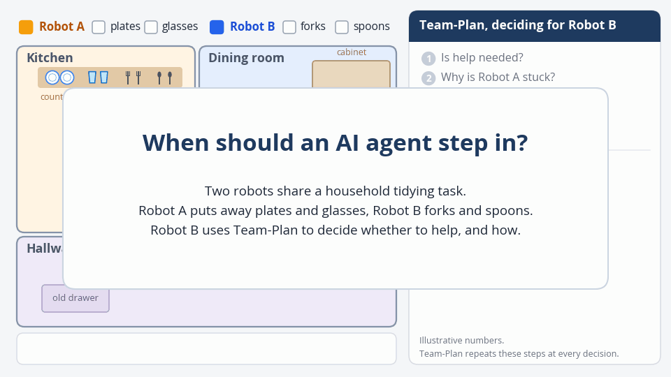
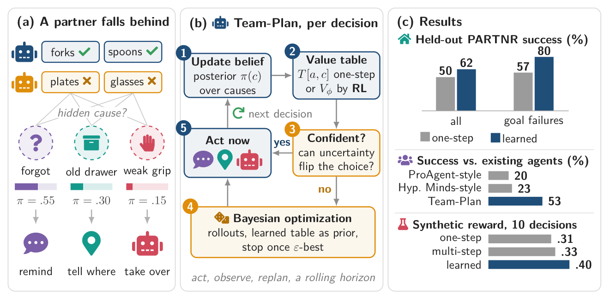
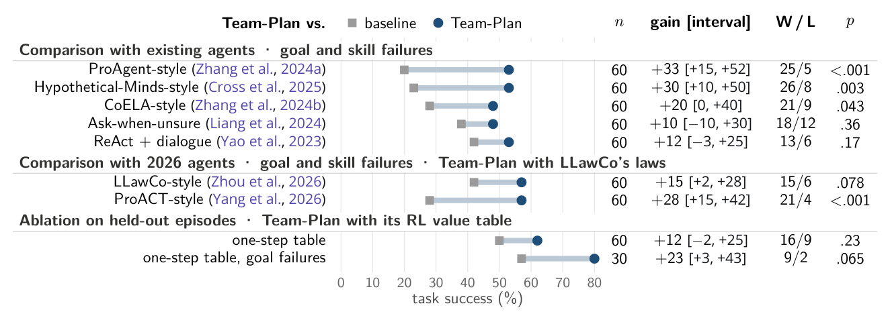
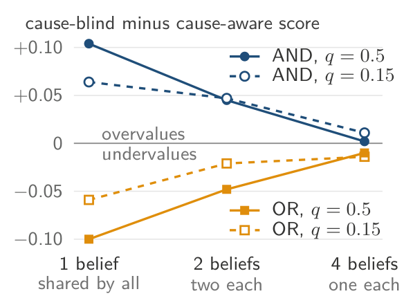
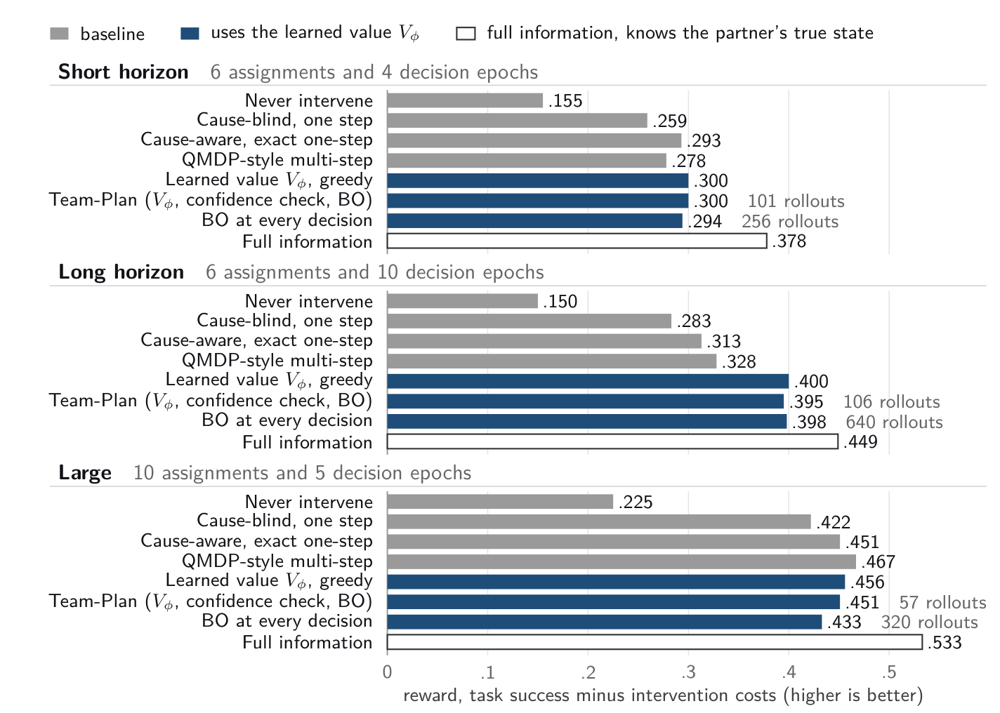

# Team-Plan

Code and results for **When Should an AI Agent Step In? Reinforcement Learning and Evaluation under Partner
Uncertainty** by Hamed Khosravi and Xiaoming Huo (Georgia Institute of Technology).

<p align="center">
  
</p>
<p align="center"><em>The paper's running example, animated. Robot A leaves the plates untouched, and Robot B uses
Team-Plan to decide whether to step in and how. Team-Plan weighs the possible causes, scores each kind of help by its
gain for the whole task, sends a reminder, and switches to a takeover once a failed pick points to a weak grip.
A schematic with illustrative numbers, not a simulator recording
(<a href="docs/assets/team_plan_demo.mp4">full-resolution MP4</a>).</em></p>

Two robots share a household task. When the partner leaves an assignment unfinished, the second robot can remind it,
tell it where an object is, take over, or continue its own work, without knowing what went wrong. Team-Plan keeps a
belief over the partner's problem and scores each intervention by its expected effect on full-task success, the
product of how much it helps its targets (benefit) and how likely the remaining work is to finish (importance). It
learns delayed effects from simulated rewards and compares uncertain choices with simulated rollouts.

<p align="center">
  
</p>
<p align="center"><em>Overview, Figure 1 of the paper. (a) Each hidden cause calls for a different intervention.
(b) One Team-Plan decision. (c) The main results.</em></p>

This repository contains

- the decision model, the synthetic benchmark, the learned value and the rollout-based comparison (`ccrp/`),
- the PARTNR integration with Team-Plan and the six reimplemented agents it is compared with (`partnr/`),
- the outputs of every run behind the paper's figures and tables (`results/`),
- one script that recomputes the paper's numbers from those outputs (`scripts/reproduce.py`).

## Quick start

Requires Python 3.9 or later. Recomputing the paper's numbers takes about 15 seconds on a laptop CPU and needs no GPU,
simulator or model download.

```bash
git clone https://github.com/HamedKhosravi99/team-plan.git
cd team-plan
python -m pip install --upgrade pip      # editable installs need pip 21.3 or later
python -m pip install -e ".[dev]"
python scripts/reproduce.py all      # prints every table and writes results/derived/*.json
python -m pytest -q                  # 53 tests
```

`python scripts/reproduce.py figure2` recomputes a single artifact. The choices are `figure2`, `figure3`,
`figure_c1`, `table_d1`, `appendix_d`, `coverage` and `theory`.

## Results at a glance

**Team-Plan against other agents in PARTNR** (Figure 2). Success of Team-Plan and each baseline on the same
episodes, with 95% cluster-bootstrap intervals, wins and losses on the pairs only one side solved, and exact McNemar
tests. Recompute with `python scripts/reproduce.py figure2`.

<p align="center"></p>

**Why averaging benefit and importance misleads** (Figure 3). When one wrong belief underlies several assignments,
the cause-blind score overvalues a takeover in tasks where every assignment must finish (AND) and undervalues it where
any one finished assignment is enough (OR). The error almost disappears when each assignment has its own belief.
Recompute with `python scripts/reproduce.py figure3`.

<p align="center"></p>

**Learning delayed effects** (Figure C1). Reward of each policy in three synthetic settings. With ten decisions per
episode the learned value earns clearly more than one-step and QMDP-style planning. Recompute with
`python scripts/reproduce.py figure_c1`.

<p align="center"></p>

## Paper to code and data

| Paper | Content | Data | Produced by | Recompute |
|---|---|---|---|---|
| Figure 1 | Method overview, illustrative | | | |
| Figure 2 | Paired PARTNR success of Team-Plan and each baseline, with cluster-bootstrap intervals, exact McNemar tests and Holm-corrected p-values over the seven agent comparisons | [`results/derived/figure2.json`](results/derived/figure2.json), from [`results/partnr/`](results/partnr) | agents in [`partnr/habitat_llm_ext/`](partnr/habitat_llm_ext), runs by [`partnr/run_shard.sh`](partnr/run_shard.sh), episode table by [`partnr/analyze_runs.py`](partnr/analyze_runs.py) | `python scripts/reproduce.py figure2` |
| Figure 3 | Bias of the cause-blind score for a first-decision takeover in four-assignment tasks | [`results/derived/figure3.json`](results/derived/figure3.json) | exact decision model in [`ccrp/synthetic.py`](ccrp/synthetic.py), tasks in [`ccrp/coupling_sweep.py`](ccrp/coupling_sweep.py) | `python scripts/reproduce.py figure3` |
| Figure C1 | Synthetic reward of each policy in the three planning settings | [`results/derived/figure_c1.json`](results/derived/figure_c1.json), from [`results/synthetic/rl/`](results/synthetic/rl) | [`ccrp/rl_experiment.py`](ccrp/rl_experiment.py) (`raw_*.json`), [`ccrp/rl_sweep.py`](ccrp/rl_sweep.py) with `--safe` (Team-Plan row, `sweep_*_safe.json`) | `python scripts/reproduce.py figure_c1` |
| Table C1 | Baselines | | [`partner_model_planner.py`](partnr/habitat_llm_ext/planner/partner_model_planner.py) (six reimplemented agents), [`message_aware_planner.py`](partnr/habitat_llm_ext/planner/message_aware_planner.py) (ReAct + dialogue) | |
| Table C2 | Parameters of the PARTNR decision model and the synthetic tasks | [`results/partnr/calibration/`](results/partnr/calibration) | [`responsibility_model.py`](partnr/habitat_llm_ext/responsibility_model.py) and [`ccrp_robot_planner.yaml`](partnr/conf/planner/ccrp_robot_planner.yaml) (PARTNR), [`ccrp/synthetic.py`](ccrp/synthetic.py) and [`ccrp/rl_experiment.py`](ccrp/rl_experiment.py) (synthetic), fit by [`ccrp/partnr_calib.py`](ccrp/partnr_calib.py) | |
| Table D1 | Wins and losses against ReAct + dialogue by Team-Plan's intervention | [`results/derived/table_d1.json`](results/derived/table_d1.json) | [`scripts/reproduce.py`](scripts/reproduce.py) | `python scripts/reproduce.py table_d1` |
| Table D2 | Silent implementation failures found by audits | descriptive | | |
| Algorithm 1 | One Team-Plan decision epoch | | [`ccrp_robot_planner.py`](partnr/habitat_llm_ext/planner/ccrp_robot_planner.py) (PARTNR), [`ccrp/rl.py`](ccrp/rl.py) (learned value, confidence check and Bayesian optimization) | |
| Appendix A | Coverage of the error widths | [`results/derived/coverage.json`](results/derived/coverage.json), from [`results/synthetic/rl/coverage.json`](results/synthetic/rl/coverage.json) | [`ccrp/rl_coverage.py`](ccrp/rl_coverage.py) | `python scripts/reproduce.py coverage` |
| Appendix C | Theory checks and the reward gap of cause-aware planning | [`results/derived/theory.json`](results/derived/theory.json), from [`results/synthetic/theory/`](results/synthetic/theory) and [`results/synthetic/coupling/`](results/synthetic/coupling) | [`ccrp/experiments.py`](ccrp/experiments.py), [`ccrp/coupling_sweep.py`](ccrp/coupling_sweep.py) | `python scripts/reproduce.py theory` |
| Appendix C | Learned value used in PARTNR | [`value_partnr_v2.pkl`](partnr/habitat_llm_ext/data), trained in the 32 worlds of [`plausible_worlds.json`](results/partnr/calibration/plausible_worlds.json) | [`ccrp/partnr_sim.py`](ccrp/partnr_sim.py), [`ccrp/partnr_rl.py`](ccrp/partnr_rl.py) | |
| Appendix D | Share of the task completed and agreement of two identical Team-Plan runs | [`results/derived/appendix_d.json`](results/derived/appendix_d.json) | [`scripts/reproduce.py`](scripts/reproduce.py) | `python scripts/reproduce.py appendix_d` |

### PARTNR runs behind Figure 2

| Folder in `results/partnr/` | Figure 2 rows | Agents (code names) | Episodes | Shards | `INJ_SEED_MOD` |
|---|---|---|---|---|---|
| `existing_agents` | ProAgent-style, Hypothetical-Minds-style, ReAct + dialogue | `ccrp`, `proagent`, `hypminds`, `react_dialog` | 20 to 49 | 2 | |
| `existing_agents_rerun` | CoELA-style, ask-when-unsure | `ccrp`, `coela`, `introspect` | 20 to 49 | 6 | 2 |
| `agents_2026` | LLawCo-style, ProACT-style | `ccrp_laws`, `llawco`, `proact` | 20 to 49 | 6 | 2 |
| `learned_value_heldout` | learned value against the one-step table | `ccrp_rl2`, `ccrp` | 50 to 79 (held out) | 6 | 2 |

Every run injects a goal failure and a skill failure into each episode (`SEED_BY=episode_id`), and both robots use
Qwen2.5-7B-Instruct with greedy decoding in bfloat16 on NVIDIA A100 or H200 GPUs. `existing_agents` and
`existing_agents_rerun` contain two runs of the same Team-Plan configuration, which Appendix D compares.

## Names used in the code

The code keeps the project's working names, which also appear in configuration and result folder names.

| Code | Paper |
|---|---|
| `ccrp` (package and PARTNR configuration) | Team-Plan, with the one-step table in PARTNR |
| `ccrp_laws` | Team-Plan with LLawCo's laws as decision-model terms |
| `ccrp_rl2` | Team-Plan with the learned value |
| `react_dialog` | ReAct + dialogue |
| `proagent`, `hypminds`, `coela`, `introspect`, `llawco`, `proact` | ProAgent-, Hypothetical-Minds-, CoELA-style, ask-when-unsure, LLawCo-, ProACT-style |
| `partner_blind`, `myopic`, `blind_one_step` | cause-blind score or planner |
| `one_step`, `exact` | cause-aware exact one-step planner, QMDP-style multi-step planner |
| `certificate`, `certified` | confidence check, check passed |
| `goal`, `skill` injection | goal failure, skill failure |
| `validation`, `long`, `large-and6` | short horizon, long horizon and large synthetic settings |

Some comments in the code use earlier numbers for the theorems.

## Repository layout

```
ccrp/                      decision model and synthetic experiments
  core.py                    beliefs, one-step action values, cause-aware and cause-blind scores
  synthetic.py               synthetic benchmark (AND/OR tasks, hidden partner components, exact model)
  planning.py, policies.py   cause-aware planners and baseline policies
  rl.py                      learned value (fitted Monte Carlo policy iteration), confidence check, Bayesian optimization
  rl_experiment.py, rl_sweep.py, rl_table.py, rl_coverage.py, rl_eval.py, rl_query_check.py
  experiments.py             theory checks
  coupling_sweep.py          four-assignment tasks with shared beliefs (Figure 3)
  partnr_sim.py, partnr_calib.py, partnr_rl.py   PARTNR simulator, its calibration, the learned PARTNR value
partnr/                    PARTNR integration, installed into a partnr-planner checkout
  habitat_llm_ext/           planners (Team-Plan, reimplemented agents, ReAct + dialogue), message tool,
                             failure injection, decision model, learned value
  conf/                      Hydra configurations
  install_ext.sh             installs the extension and patches the local model loader
  run_shard.sh               runs one shard of one agent under one partner failure
  analyze_runs.py            per-episode outcomes, paired tables, intervention counts
  cluster_bootstrap.py       paired differences with episode-clustered intervals
scripts/reproduce.py       recomputes the paper's numbers from results/
results/                   run outputs (see results/README.md) and derived JSON
tests/                     unit tests, including an offline harness for the PARTNR planner
docs/make_animation.py     draws the animation at the top of this page
docs/assets/               animation, its MP4 version and the figures shown on this page
```

To redraw the animation, run `python docs/make_animation.py --mp4` (the MP4 needs `pip install imageio-ffmpeg`).

## Re-running the experiments

### Synthetic experiments (CPU)

These commands regenerate the saved outputs in `results/synthetic/`. Run them with `OMP_NUM_THREADS=1`, since every
worker process would otherwise start its own threads, and set `--procs` to the number of cores.

```bash
export OMP_NUM_THREADS=1
python -m ccrp.rl_experiment --smoke              # a small run that checks the learning pipeline end to end

# theory checks (100 episodes) and the four-assignment tasks of Figure 3
python -m ccrp.experiments --exp all --out results/synthetic/theory
python -m ccrp.coupling_sweep --n 200 --out results/synthetic/coupling --procs 8

# Figure C1: learn the values and evaluate the policies on fixed seeds (200 episodes, 300 in the long horizon)
python -m ccrp.rl_experiment --out results/synthetic/rl --settings validation,large-and6 --eval 200 --procs 9
python -m ccrp.rl_experiment --out results/synthetic/rl --settings long --eval 300 --procs 9
# add policies to raw_<setting>.json on the same seeds, here the QMDP-style planner and full information
python -m ccrp.rl_eval --setting long --out results/synthetic/rl --eval 300 --baselines exact,full_info --eps "" --no-deep --procs 9
# Team-Plan row, with the safe switch to the final leader (one setting per call)
python -m ccrp.rl_sweep --setting long --episodes 3000 --iterations 3 --eval 300 --safe --procs 9

# Appendix A, coverage of the error widths
python -m ccrp.rl_coverage --settings validation,long,large-and6 --states 150 --ref 64 --procs 9
```

The saved learned values (`results/synthetic/rl/value_<setting>.pkl`) let `ccrp.rl_eval` and `ccrp.rl_coverage` run
without retraining. Use `--eval 300` for `long` and `--eval 200` for `validation` and `large-and6`.

### PARTNR experiments (GPU)

1. Install [partnr-planner](https://github.com/facebookresearch/partnr-planner) with Habitat 3.0 and download the
   PARTNR episodes and assets as its instructions describe. Both robots' models fit on one 48 GB GPU.
2. Install this extension into the checkout. The installer copies `ccrp/` and `partnr/habitat_llm_ext/`, adds the
   Hydra configurations and patches the local model loader and episode loop.

   ```bash
   bash partnr/install_ext.sh /path/to/partnr-planner .
   ```

3. Run every shard of every cell, for example the first row of the table above.

   ```bash
   export PARTNR_PLANNER=/path/to/partnr-planner SEED_BY=episode_id
   for agent in ccrp proagent hypminds react_dialog; do
     for failure in goal skill; do
       for shard in 0 1; do
         bash partnr/run_shard.sh $agent $failure $shard 2 30 20 runs/existing_agents
       done
     done
   done
   ```

   The other runs use 6 shards and `INJ_SEED_MOD=2`, with episodes from 20 (`... $shard 6 30 20 ...`) or, for the
   held-out run, from 50 (`... $shard 6 30 50 ...`).

4. Summarize the runs.

   ```bash
   python partnr/analyze_runs.py runs/existing_agents --paired ccrp
   python partnr/cluster_bootstrap.py runs/existing_agents --ref ccrp
   ```

## Notes on the data

- Each PARTNR cell `<agent>__<failure>/shard<k>/` keeps `results/episode_result_log.csv` (success and share of the
  task completed per episode), the benchmark's per-episode `stats/` files, Team-Plan's decision logs
  (`ccrp_decisions*.jsonl`) or the reimplemented agents' logs (`partner_model*.jsonl`), and for `agents_2026` the
  planner's standard output. Prompts, full traces and videos are not included.
- An episode that crashes inside the benchmark counts as a failure for the configuration that crashed. The analysis
  finds such episodes in `stats/` or, where only standard output was kept, from its crash marker.
- Intervals are 95% percentile intervals from 100,000 cluster-bootstrap resamples of base episodes (seed 0). With 30
  base episodes the bootstrap distribution sits on a grid of 1/60, so fewer resamples can move a bound by one step.
- Absolute paths in logged tracebacks are replaced by `<partnr_root>`.
- The repository includes the run outputs behind the paper's figures and tables, not the other runs of the project.

## Citation

```bibtex
@misc{khosravi2026teamplan,
  title  = {When Should an AI Agent Step In? Reinforcement Learning and Evaluation under Partner Uncertainty},
  author = {Khosravi, Hamed and Huo, Xiaoming},
  year   = {2026},
  note   = {Code and results: https://github.com/HamedKhosravi99/team-plan}
}
```

## License

MIT, see [LICENSE](LICENSE). PARTNR, Habitat and Qwen2.5 are separate projects under their own licenses.
